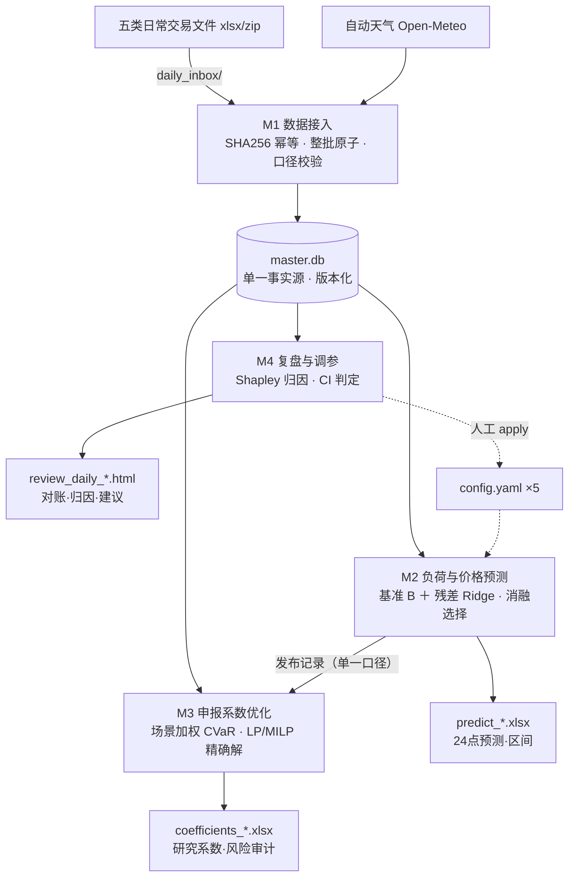

# power-trading-suite

广东电力现货市场 · 售电侧研究系统——**数据接入 → 负荷/价格预测 → 申报系数优化 → 复盘调参**，单库四模块的完整研究闭环。

> ⚠️ 定位是**研究系统**：实际申报系数恒为 1（中性申报）；优化产出的研究系数与调参建议仅供人工复核，任何参数变更都需显式确认后才会生效，不含自动交易执行。本仓库**不含任何真实交易数据**——发布版已清除全部本地数据、运行结果与训练缓存，仅保留代码、文档与纯表头模板。

## 架构



## 特性

| 模块 | 职责 | 关键机制 |
|---|---|---|
| M1 `data_ingest`＋`disclosure_ingest` | 原始文件 → 可信事实 | 同内容 SHA256 幂等跳过；整批事务回退；负负荷隔离、零价按缺失、96 点完整才聚合小时 |
| M2 `load_forecast` | 明日 24 点负荷/价格/区间 | 同日型加权基准 B（14 天半衰期）＋残差 Ridge；消融考试选特征组；窗口随目标日滚动；available_time ≤ 决策截点防泄漏 |
| M3 `coefficient_opt` | 24 小时申报系数研究 k∈[0.8,1.2] | 90 天场景（负荷误差×价差配对，保留相关性）近期加权；均值−λ·CVaR＋超限机会约束；LP/MILP 精确解（HiGHS）；±20% 获利回收计价；邻域稳健度 |
| M4 `review` | 对账 → 归因 → 调参建议 | 版本化对账；Shapley 三因素归因（顺序无关、加总恒等）；日块 bootstrap CI 下界 > 0 判定；候选回测进程池并行 |

## 安装

Python 3.9–3.13（双栈验证）：

```bash
pip install -r requirements.txt
```

## 快速开始

1. **准备数据**：把交易中心日常文件放入 `daily_inbox/`——零售用户电量 / 现货价格 / 组织中心实际结果 / 中调实际披露（zip）/ 次日预测披露；手填格式参考 `data_ingest/data/输入模板.xlsx`（纯表头模板）
2. **一键运行**：`python main.py all`（Windows 可双击 `一键日常导入并生成.bat`）——导入 → 天气 → 预测 → 系数 → 复盘，全程约 5~8 分钟
3. **看报告**：按《报告阅读指南.md》的"十分钟速读路径"——昨日复盘 html → 明日预测 xlsx → 研究系数 xlsx → 调参建议 yaml

常用命令：`python main.py ingest|disclosure|load|coefficient|review`

## 测试

```bash
python run_tests_windows.py
```

5 套 **116 项**，基于合成数据自检（无数据环境下 115 项通过 + 1 项依赖本地示例数据自动跳过）。

## 文档

| 文档 | 内容 |
|---|---|
| `系统说明文档.html` | 图文总览：架构图 / 日常流水线 / 四模块卡片 / 算法直觉三图（浏览器打开） |
| `报告阅读指南.md` | 逐 sheet 读法＋15 条概念速记＋红旗清单 |
| `先看这里_三步操作.md` | 日常三步操作 |
| `迭代说明_v1.1.md` / `迭代说明_v1.2.md` | 版本演进与口径变更（v1.2 含六份算法优化阶段文档） |
| `自动天气使用说明.md` | Open-Meteo 天气接入 |
| `load_forecast/SPECIFICATION.md` 等 | 各模块规格与验收记录 |

## 设计原则

- **研究模式**：research_k ≠ adopted_k，实际申报恒为中性，优化结果只做复核参考
- **单一事实源**：全部数据进出 `master.db`，版本化＋原始字节留存，任意批次可回溯
- **诚实边界**：未认证的发布时点显式标注；空披露不当实际值；指标跨口径不可混比清单随文档交付
- **防泄漏成体系**：训练 / 校准 / 策略全链同一信息截点，三重校验

## 免责声明

本项目用于电力现货市场的**研究与学习**：所有预测与优化结果均为研究性质，不构成投资建议；使用者需自行核对所在市场的规则、结算口径与数据权限。

## License

[MIT](LICENSE)
