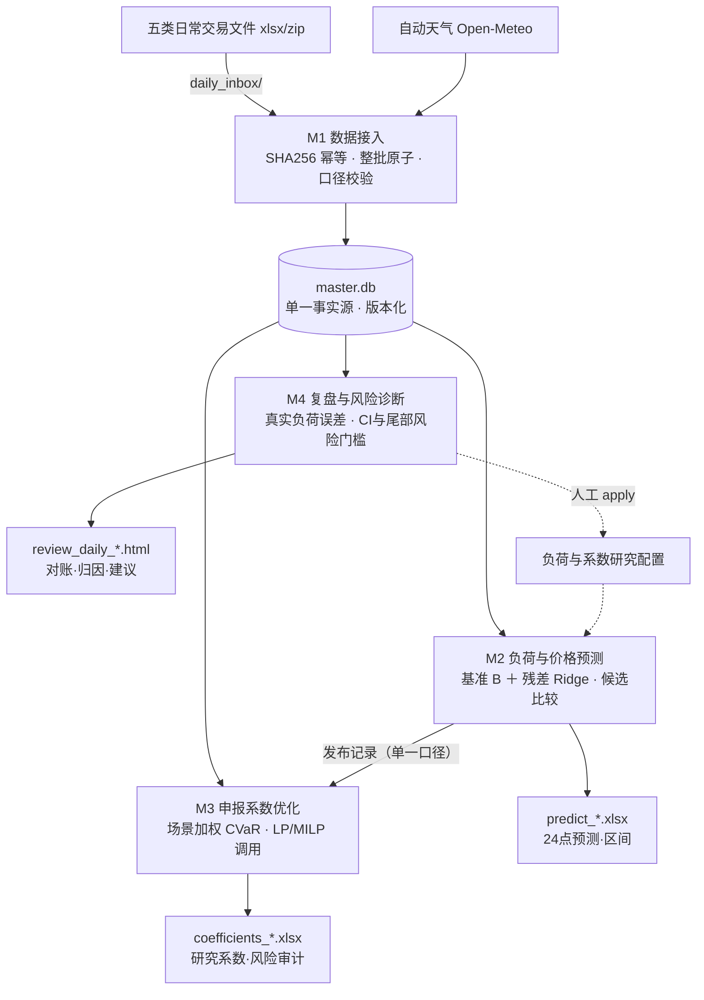

# power-trading-suite

广东电力现货市场 · 售电侧研究系统——**数据接入 → 负荷/价格预测 → 申报系数优化 → 复盘调参**，单库四模块研究流程。

当前小版本：**v1.2.1-research**（2026-11-12），见[迭代说明](迭代说明_v1.2.1.md)与[验收记录](docs/validation/v1.2.1/README.md)。M2增加星期/假期阶段特征，M4增加真实负荷预测误差诊断；M3同步事前原始预测误差接线。

> 定位是**研究系统**：采用系数列固定为 1（中性基准）；研究系数与调参建议供人工复核，参数变更需显式 apply，不含自动交易执行。发布版已清除本地业务数据、训练缓存及相关运行结果，不能仅凭代码复现真实经营成绩。

## 先理解输入 算法与输出

- [输入数据到算法输出详解](docs/输入数据到算法输出详解.md)：每类资料的用途、负荷与价格公式、整日场景、系数目标、Shapley 归因及输出读法。
- [实现状态与待核问题](docs/实现状态与待核问题.md)：公开版问题的修复状态、历史基线与剩余边界。

v1.2.1补齐公开版漏发的M2输入适配源码，修复六类日型软借、CI方向与生成/apply门槛不一致；新增原始预测/实际版本配对。没有业务数据库时可运行合成测试；真实全链预测、结算口径和经营效果仍需在用户研究环境验证。

## 架构



## 特性

| 模块 | 职责 | 关键机制 |
|---|---|---|
| M1 `data_ingest`＋`disclosure_ingest` | 原始文件 → 可追溯事实 | SHA256 幂等、事务及来源记录；单位/合计/主键校验；披露区分完整、降级与未提供 |
| M2 `load_forecast` | 明日 24 点负荷/价格/区间 | binary加权B＋增强星期/假期阶段残差Ridge；basic可对照，six软借已修；负荷默认固定规格；披露按接收截点过滤 |
| M3 `coefficient_opt` | 24 小时研究 k∈[0.8,1.2] | 优先同模型版本原始M2整日负荷/价格误差；不足30天明确proxy研究对照；30日半衰期、CVaR及超限约束；采用系数仍1 |
| M4 `review` | 对账 → 误差诊断 → 归因 → 调参建议 | 原始事前预测唯一配对、偏差与残差分布；Shapley；幅度+双段CI门槛；风险候选另查尾损/同限额超限/可行率不恶化 |

## 安装

本次实际验证环境为Python 3.12，具体依赖版本见验收记录。旧v1.2的3.9/3.13双栈记录保留为历史证据，不能替代新版本在其他环境的复验。

```bash
pip install -r requirements.txt
```

## 快速开始

1. **准备数据**：把交易中心日常文件放入 `daily_inbox/`——零售用户电量 / 现货价格 / 组织中心实际结果 / 中调实际披露（zip）/ 次日预测披露；手填格式参考 `data_ingest/data/输入模板.xlsx`（纯表头模板）
2. **日常入口**：`python daily_import.py`（Windows 可双击 `一键日常导入并生成.bat`）——先分流 `daily_inbox/`，再调用导入 → 天气 → 预测 → 系数 → 复盘。输入已分发到模块目录时可用 `python main.py all`。完整预测仍需已有研究数据库、客户映射及天气等输入；空库不能直接预测。
3. **看报告**：按《报告阅读指南.md》的"十分钟速读路径"——昨日复盘 html → 明日预测 xlsx → 研究系数 xlsx → 调参建议 yaml

常用子命令：`python main.py input`、`disclosure`、`load`、`coefficient`、`review`。采用参数回写需显式 `apply`，支持 `rollback`。

## 测试

```bash
python run_tests_windows.py
python -m unittest discover -s disclosure_ingest/tests -v
```

本版本的实际测试数、环境和离线冒烟证据见[验收记录](docs/validation/v1.2.1/README.md)。真实数据测试缺少业务库时跳过；合成测试与演示指标不能替代真实经营效果。

## 文档

| 文档 | 内容 |
|---|---|
| [迭代说明_v1.2.1](迭代说明_v1.2.1.md) | 日历增强、真实误差来源、M4风险门槛、验证与回退 |
| [输入数据到算法输出详解](docs/输入数据到算法输出详解.md) | 数据用途、清洗、预测公式、场景、系数目标、复盘与输出 |
| [实现状态与待核问题](docs/实现状态与待核问题.md) | 公开版缺失、时点、CI方向、回写门槛及求解待核事项 |
| `系统说明文档.html` | 图文总览：架构图 / 日常流水线 / 四模块卡片 / 算法直觉三图（浏览器打开） |
| `报告阅读指南.md` | 逐 sheet 读法＋15 条概念速记＋红旗清单 |
| `先看这里_三步操作.md` | 日常三步操作 |
| `迭代说明_v1.1.md` / `迭代说明_v1.2.md` | 版本演进与口径变更（v1.2 含六份算法优化阶段文档） |
| `自动天气使用说明.md` | Open-Meteo 天气接入 |
| `load_forecast/SPECIFICATION.md` 等 | 各模块规格与验收记录 |

## 设计原则

- **研究模式**：research_k 与 adopted_k 分列，采用系数固定 1，优化结果只作复核参考
- **单一事实源**：全部数据进出 `master.db`，版本化＋原始字节留存，任意批次可回溯
- **诚实边界**：未认证的发布时点显式标注；空披露不当实际值；指标跨口径不可混比清单随文档交付
- **时点控制需逐链核验**：天气已有接收截点检查；披露及历史发布选择仍有已记录缺口，不能据此声称全链严格事前可用

## 免责声明

本项目用于电力现货市场的**研究与学习**：所有预测与优化结果均为研究性质，不构成投资建议；使用者需自行核对所在市场的规则、结算口径与数据权限。

## License

[MIT](LICENSE)

