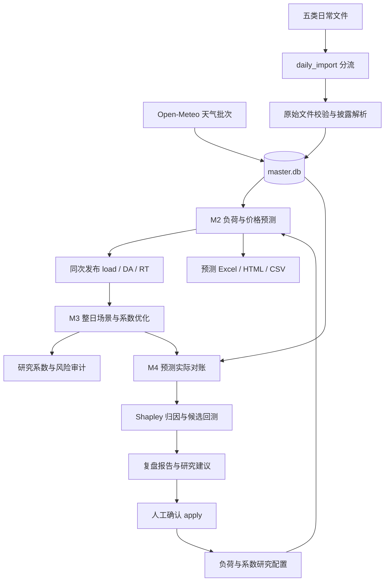

# 从输入数据到预测 系数与复盘输出

本文说明一份日常交易文件进入系统后，如何转换为特征、预测、风险场景、研究系数和复盘结果。适合先理解业务链路，再定位具体实现。

核查日期：2026-11-11。代码基准：[b679b202](https://github.com/MultiplyTen/power-trading-suite/tree/b679b20236db134789f58a2312bee1644c3d2b7e)，对应 v1.2 算法优化公开版。本文为代码阅读说明，没有重新训练、运行交易或复现历史经营成绩。后续代码变更应同步复核本文。

**阅读前先看 [实现状态与待核问题](实现状态与待核问题.md)。** 该快照存在输入适配模块缺失、历史时点筛选和调参判定不一致等问题。下文区分已有计算代码、配置默认值、设计目标和待核事项；不代表新克隆已能完整运行。

## 1 先看完整链路



当前日常主线是**明日 24 点**。多日参考接口与独立月前模型不能混同，默认 `reference_days: 0`。系统没有交易平台下单接口；M3 的采用系数列固定为 1，研究系数另列。

## 2 输入数据分别做什么

| 输入 | 提取内容 | 主要用途 | 不能直接推导的内容 |
|---|---|---|---|
| 零售用户电量 XLSX | 客户编码、名称、日期、24 小时电量、日合计 | 客户及组合负荷标签，历史水平和滞后特征，城市天气权重 | 全省统调负荷、已认证生产计划 |
| 现货价格 XLSX | 小时日前价 DA、实时价 RT | 用户侧价格预测标签、历史价差及误差校准 | 单节点价格和用户结算价之间的自动等同 |
| 组织中心实际结果 ZIP | 实际用电量、日前成交电量、日前及实时统一结算价 | 用电量与价格对照、真实申报执行对账 | 完整正式结算利润 |
| 中调实际披露 ZIP | 统调实际负荷等 | 全省统调预测、供需研究与对照 | 客户实际需求 |
| 次日预测披露 XLSX | 统调、风光、水电抽蓄、备用等曲线 | 形成价格模型的披露特征候选 | 已认证备用裕度、实际拥塞或出清因果 |
| 检修、阻塞及机组约束 | 事件、文本和约束上下文 | 保存在披露事件及审计表中供核查 | 当前代码没有把所有事件都转换成有效预测特征 |
| 天气预报 | 温度、湿度、降水、辐射、风速、云量、天气代码 | 负荷及价格天气特征 | 用事后实况替代当时预报的严格历史效果 |
| 内置日历及客户地区映射 | 星期、工作日、假日、调休、城市 | 匹配同类日、客户天气和组合天气 | 行政工作日不自动等于企业实际生产日 |

源码入口：[文件分流](../daily_import.py#L38-L65)、[零售及价格解析](../data_ingest/raw_sources.py#L60-L117)、[组织中心及中调实际](../data_ingest/raw_sources.py#L118-L152)、[披露指标映射](../disclosure_ingest/parser.py#L19-L41)。

### 2.1 清洗与单位

- 客户小时电量使用 MWh。源单位为 kWh 时按配置除以 1000；源文件未标单位时仍需提供方确认。
- 统调及数值披露功率曲线保留 MW。15 分钟功率聚合小时均值，不能与小时电量直接相加。
- 手填模板的 96 点电量按小时求和；价格按小时算术均值代理，不能自动称为正式加权结算价。
- 零售单客户零电量保留，组合负荷要求大于 0；负值与非法范围需要处理。不同输入通道的校验规则并非完全相同。
- 当前价格通道把零价格视为缺失，负价格按范围保留。是否存在有效零价需要按来源重新确认。
- 客户日合计要与 24 小时求和一致；日期、小时和业务主键不能重复。缺失不自动补零。
- 披露小时保留 `complete / degraded_partial / unavailable` 状态；模型特征读取只选 `complete` 预测曲线。空表头不代表数值为零。

源码：[原始校验](../data_ingest/raw_sources.py#L44-L87)、[模板聚合](../data_ingest/validation.py#L64-L72)、[披露小时质量](../disclosure_ingest/parser.py#L248-L266)。

### 2.2 单库与版本

原始字节、SHA256、导入批次、源单元格及修订信息与业务数据一起保留。业务读取使用 `master.db` 的事实表和版本表，不依靠把输出 Excel 重新解析为下一模块输入。

核心记录包括：

| 数据层 | 例子 | 作用 |
|---|---|---|
| 小时事实 | `负荷`、`日前价`、`实时价` | 当前业务值 |
| 披露 | `disclosure_points`、`disclosure_hourly`、`disclosure_events` | 原始时点、小时曲线、事件与质量 |
| 天气 | `weather_batches`、`weather_points` | 接收时间、原始响应及逐城市逐小时版本 |
| 预测发布 | `runs`、`predictions` | 同次发布的目标小时、模型、配置和结果 |
| 实际对账 | `actuals` | 已到达实际值及修订版本 |

**版本化支持追溯，不等于历史可得时间已经认证。** 当前披露特征与统一发布读取仍存在按最新版本读取的问题，详见 [状态说明 D02](实现状态与待核问题.md#d02-历史可得时间与截止并未全链统一)。

## 3 日常入口和运行顺序

把五类日常文件放进 `daily_inbox/` 后，使用：

```bash
python daily_import.py
```

该入口先分流到原始数据及披露 inbox，再调用 `main.py all`。文件成功完成流程后进入 `daily_processed/`；失败时源文件保留以便修正。

输入已经分发到模块目录时，可使用：

```bash
python main.py all
```

主链顺序为披露导入、原始数据及天气接入、M2 预测、M3 系数、M4 复盘。M2 失败后虽然保留手填负荷检查路径，**当前 M3 仍要求完整的 M2 load/DA/RT 发布**，不能只填负荷就绕过价格发布。

当前默认配置：目标日 `tomorrow`，决策截点 D−1 12:30，M2/M3 观测滞后同为 6 天。这里是研究配置，不是对市场正式申报截止的认定，也不是按每个来源动态推断最新日。

源码：[分流入口](../daily_import.py#L81-L109)、[主链与边界校验](../main.py#L11-L57)。

## 4 M2 负荷预测

### 4.1 同类日基准 B

对每个客户、客户组合和统调分别预测。默认日型为工作日与休息日二类，按同小时取历史样本。

当前默认 `observation_lag_days=6`、`baseline_window_days=28`，所以目标日 D 的基准回看 D−6 至 D−33。权重随历史距离衰减：

$$
w_\ell=2^{-\ell/14}
$$

$$
B_{D,h}=\frac{\sum_{\ell\in\mathcal H}w_\ell L_{D-\ell,h}}{\sum_{\ell\in\mathcal H}w_\ell}
$$

其中同类日集合为 $\mathcal H$。没有同类样本时，退回可得同小时历史均值。

六类日型已实现为候选，但阶段文档记录同窗实验退化，因此默认 `binary`。不能把“细分日型有实现”写成“细分日型已提高效果”。

### 4.2 残差模型解释基准之外的变化

令 A 为滞后负荷的 672 小时滚动均值，至少需要 168 小时，并设置 0.001 的尺度下限。模型预测标准化残差：

$$
r_t=\frac{L_t-B_t}{A_t},\qquad
\widehat L_t=\max(B_t+A_t\widehat r_t,0)
$$

特征包括：

- 可得的 6/7/14 日同小时相对负荷；
- 同小时近期 7 个可得日的平均水平；
- 基准与近期水平之差；
- 日历周期、假期和调休特征；
- 制冷度、制冷度平方、温湿交互、7 日温差、降雨对数、辐射、风速、云量及白天热度。制冷度为 `max(温度−阈值,0)`，平方项不是原温度的平方。

模型流水线为**中位数填补缺失 → 标准化 → Ridge**。滚动训练窗口默认 120 天、最少 56 天、每日重训；组合/客户默认 Ridge α=1000，统调 α=100。14 天半衰期用于基准 B；当前 `walk()` 调用 `model.fit(X,y)` 未传 `sample_weight`，Ridge 训练样本默认等权。

客户取映射城市天气；组合天气按滞后历史客户电量构造城市权重；统调采用各市等权代理。它们不是同一条天气输入。

### 4.3 当前负荷配置与自动选择的区别

`training.selection_mode` 默认是 `fixed`。程序计算有天气、无天气、基准及 lag7 对照，但**默认负荷主结果按配置选定，不按本次验证 WMAPE 自动选最优**。价格模型的候选选择另行执行。

此外，当前返回的 `selection_status` 在有有效对照记录时仍可能标 `validation_selected`，即使负荷处于 fixed 模式。读结果应同时检查实际配置与 `selected_model`，不能只看这个状态字符串。

源码：[负荷特征与基准](../load_forecast/features/load.py#L19-L56)、[模型流水线](../load_forecast/models/base.py#L13-L30)、[负荷选择](../load_forecast/evaluation/rolling_backtest.py#L70-L95)、[配置](../load_forecast/config.yaml)。

## 5 M2 价格 方向概率与区间

### 5.1 DA 和 RT 分别预测

当前主要结构为：

$$
\widehat{DA}_t=B_{DA,t}+\widehat e_{DA,t},\qquad
\widehat{RT}_t=B_{RT,t}+\widehat e_{RT,t}
$$

$$
\widehat S_t=\widehat{RT}_t-\widehat{DA}_t
$$

价格残差使用 Ridge 候选，并与基准、lag7 比较。当前不是“直接回归价差后推 RT”，也不是已部署的 DA/RT 联合树模型。

### 5.2 供需与披露怎样进入模型

历史价格、历史价差、日历、样本外统调预测和天气组成基础候选。每条完整预测披露曲线生成四类特征：原值、小时变化、日均值、日极差。

候选组包含 `no_weather`、`weather`、`disclosure`、`weather_disclosure`；开启尖峰 two-part 后增加 `spike`、`weather_spike`。价格回归在选择窗口按 MAE 选候选，α 比较 10/100/1000。

**`weather` 组同时包含天气和统调预测特征。** 它与 `no_weather` 的差值不能全部解释为天气的独立贡献。检修和文本约束也不能仅因已入库就声称已被模型有效使用。

### 5.3 尖峰 方向概率与区间

- 尖峰候选使用因果滚动 90 日 P90 标签，先做 Logistic 样本外概率，再把概率及历史超阈幅度作为回归特征。候选存在不代表最终选中。
- `prob_rt_above_da` 单独比较 Logistic、90 日历史多数概率、同类小时概率等，按 log-loss 选择；不是直接把点预测正负变成概率。
- P10/P90 使用冻结选型后的可得历史误差分位数，同小时误差不足 14 个时借用合并误差；合并样本仍不足 14 个时区间保留缺失。负荷误差先除以 A、还原时再乘当前 A；价格尺度为 1。
- 名义 P10—P90 是 80% 区间，需要看实际覆盖；不自动等于经过认证的 80% 概率保证。

选择/验证/测试窗口随目标日滚动。以输出 `resolved_backtest_windows` 和共同有效样本为准；当前 `resolve_windows` 的测试范围包含锚点 D，目标日没有实际标签时不能据窗口日期推断有效计分天数。

源码：[价格特征与候选](../load_forecast/evaluation/rolling_backtest.py#L97-L170)、[披露四类特征](../load_forecast/evaluation/disclosure.py#L20-L52)、[误差区间](../load_forecast/evaluation/rolling_backtest.py#L53-L68)。

## 6 M3 从预测到研究系数

### 6.1 目标日预测统一 历史误差仍有代理

M3 强制读取 M2 同次完整的 24 点 load/DA/RT 发布，缺失即停止。目标日运行不再独立重训另一份价格。

历史校准不同：价格误差来自保留的历史滚动价格模型；当前主链无条件使用数据库实际负荷构造的滞后 28 日同小时因果基准计算历史负荷误差，没有消费原始 M2 历史预测档案。旧辅助读取函数虽然保留原始预测参数，但不在这条主链调用。**目标日同版发布，不代表历史场景来自同一个 M2 历史模型档案。**

### 6.2 生成整日配对场景

当前配置使用 90 日完整窗口，另有前置误差校准和 30 日独立验证。将每个历史日的 24 小时负荷误差及价差误差配对加到明日预测上：

$$
L_{s,h}=F_h+\varepsilon^{load}_{s,h}
$$

$$
S_{s,h}=\widehat S_h+\varepsilon^{spread}_{s,h}
$$

这里 $\varepsilon^{spread}$ 采用本文 RT−DA 符号，等于代码 `spread_error` 的相反数；不能直接把该代码字段不变号代入上式。

保持同一天跨小时、量价误差的依赖关系。某场景出现负负荷时整日排除；合格整日场景少于 30 个停止。整日权重按 30 天半衰期递减并归一化，验证表评分仍按等权。

代码内部 `spread=DA−RT`，与本文解释采用的 $S=RT−DA$ 相反，但收益函数对应取负号，方向一致。

### 6.3 场景收益与保守折减

令 $Q_h=k_hF_h$。在本文 $S=RT−DA$ 口径下：

$$
\pi_s(k)=\sum_h\left[(Q_h-L_{s,h})S_{s,h}-R_{s,h}-|Q_h-L_{s,h}|\,error\_shrink\,\sigma_h\right]
$$

profit_recovery 配置按上下带外电量及有利方向价差计算回收：

$$
R=\max(Q-uL,0)\max(S,0)+\max(lL-Q,0)\max(-S,0)
$$

当前研究配置 $l=0.8,u=1.2$。这是代码所用参数与比较口径，不据此认定当前正式结算规则已获认证。该模型没有覆盖完整合同、零售收入、税费及正式经营利润。

`|Q−L|×error_shrink×σ` 是优化使用的不利价差折减，不是实际结算费用。训练及最终场景优化传入 σ；独立验证收益表不传 σ，以其记录的回收口径另算收益，并列 k=1 对照。

### 6.4 目标 约束与求解

目标是代码定义的**绝对场景日收益均值减尾损惩罚**：

$$
U(k)=E_w[\pi_s(k)]-\lambda\max\{CVaR_{0.9,w}(-\pi_s(k)),0\}
$$

这里收益相对“实际负荷全部按 DA 购入”的比较基准；不是先减 k=1 后再优化。相对 k=1 增量在验证表中另列。

| 项目 | 当前默认值或机制 |
|---|---|
| 系数范围 | 每小时连续 $k\in[0.8,1.2]$ |
| 平滑 | 相邻小时系数变化不超过 0.05 |
| 尾损 | CVaR α=0.9，风险权重 λ=0.5 |
| 超限 | 场景加权损失超过日限额的比例不大于 10% |
| 日限额 | `auto=max(2×abs(k=1未折减等权日均收益), k=1等权日损失CVaR)` |
| 求解 | HiGHS LP，必要时加入机会约束的二元变量调用 MILP；保留网格对照与回退 |
| 0.01 步长 | 网格搜索及邻域检查使用；不限制所有连续主解必须落在 0.01 网格上 |

`auto` 仍是技术默认锚，且使用等权、未折减基准，不是用户认可的经营风险预算。10% 是场景经验超限约束，不是未来真实概率保证，也不是 CVaR 金额硬上限。

求解结果还要经过独立场景评分。邻域检查只覆盖系数域及平滑，不含机会预算检查；不能把邻域值解释为完整可行域内的最优性证明。当前 LP/MILP 的数值一致性仍需核验，见状态说明 D06。

当前主链是一套风险配置及固定系数敏感性比较，**不是原设计中已经完成的三档风险收益曲线**。

源码：[M3 主流程](../coefficient_opt/main.py#L36-L130)、[收益和风险](../coefficient_opt/coefficient_optimization.py#L41-L83)、[LP/MILP](../coefficient_opt/coefficient_optimization.py#L102-L204)、[参数](../coefficient_opt/config.yaml)。

## 7 M4 对账 归因与调参

### 7.1 分开预测 实际和执行

模型发布进入 `runs/predictions`，事实值同步到版本化 `actuals`。普通预测对账按负荷 D+4、价格 D+5 等待已到达数据；结算对照另有 14 天等待期。调参回放滞后为 5 天，前置模型观测滞后须至少 6 天。

真实日前成交电量用于执行偏差对照，结算价用于结算口径对照。Shapley 仍按记录的 $Q=F\times k$ 重建模型收益，没有直接把真实执行量替换进去。研究回放缺少原始执行证据时系数保持 1，不补造历史优化决策。

### 7.2 三因素 Shapley

因素 A 为系数选择，B 为负荷误差，C 为价格误差。计算 8 个状态，对 6 种加入顺序的边际贡献平均：

$$
\phi_A+\phi_B+\phi_C=v(ABC)-v(\varnothing)
$$

其中 $v(\varnothing)=gain(F,F,\widehat{DA},\widehat{RT})$，$v(ABC)=gain(Fk,L,DA,RT)$。它是顺序无关的会计分解，不是因果识别。

**相对实际 k=1 的超额收益另为 $v(ABC)-v(BC)$**，不能将三项贡献直接改称这项超额收益。

### 7.3 候选回测与 CI 设计目标

| 任务 | 总窗口 | 选型 | 独立验证 | 主要评分 |
|---|---:|---:|---:|---|
| 负荷 | 30 天 | 20 天 | 10 天 | WMAPE |
| 价格 | 60 天 | 40 天 | 20 天 | DA/RT 平均 MAE |
| 风险 | 60 天 | 40 天 | 20 天 | 收益评分 |

候选扫描模型、特征开关、温度阈值、正则化及风险参数，最多 4 个进程并行。配置、代码、数据库及窗口共同形成缓存指纹，数据或窗口变化需重算。

设计目标是对逐日改善重采样 2000 次，比较 95% CI：选择段改善为正且 CI 下界为正，才选择优先短板任务的最佳候选；随后要求验证段 CI 下界为正。验证失败不在尾段重新挑第二名。

**当前实现有 CI 日差反号及 apply 仍查 5% 的不一致，见 D03/D04；不能据此声称统计采纳流程已正确验证。**

多值修订冲突会阻断建议；单值晚到记录透明提示而不一律阻断。这种最终快照研究回放不等于逐历史时点版本已完整重建。

### 7.4 人工 apply

普通运行生成建议，不自动改配置。显式 apply 检查原配置哈希、旧参数、候选白名单及证据，先备份，再事务写入，失败恢复并支持 rollback。研究建议不得通过简单改布尔量回写生产模式。

源码：[Shapley](../review/attribution.py#L17-L35)、[窗口和回测](../review/suggestions.py#L56-L105)、[判定](../review/suggestions.py#L183-L218)、[apply](../review/apply_config.py#L39-L74)、[复盘配置](../review/config.yaml)。

## 8 最终输出怎么看

| 输出 | 重点字段或表 | 回答的问题 |
|---|---|---|
| `load_forecast/output/predict_*.xlsx` | 明日24点总览、客户负荷、DA/RT、P10/P90、方向概率 | 明天用多少电，价格和不确定性怎样 |
| M2 `features.csv`、`model_coefficients.csv`、`training_trace.csv` | 特征、标准化系数、训练样本与窗口 | 预测使用了什么，参数如何形成 |
| M2 `parameters.json`、`data_quality.json`、`run_manifest.json` | 配置、来源、实际窗口、缺口与降级 | 此次结果基于哪一版资料，能否评价 |
| `coefficient_opt/output/coefficients_*.xlsx` | 研究系数、网格解、采用系数、研究量与基准量 | 研究中应怎样调量，是否触达约束 |
| M3 `decision_*.html`、`audit_*.json` | 求解器、场景风险、限额、邻域、来源 | 为什么得到这组系数，有哪些限制 |
| `review/output/review_daily_*` 及周/月报告 | 误差、方向多数基准、Shapley、待复盘 | 问题集中在哪个环节 |
| `candidate_comparison.csv`、`suggestions_*.yaml` | 候选结果、CI、原因、状态 | 哪个改动值得继续核验 |
| 调整事务、备份与日志 | 原值、新值、哈希、事务状态 | 参数何时、以何事务应用，如何回退；当前未记录操作者身份 |

**研究量不等于执行量。** M3 导出的采用系数固定 1，申报基准量等于预测负荷；研究系数和研究申报量供复核，系统不自动提交交易。

M2 工作簿也保留自身策略研究字段。M3 当前目标日强制消费的是 M2 的 load/DA/RT 统一发布，再执行自己的整日优化；不能把 M2 与 M3 两套 `research_k` 当作同一算法结果混比。

## 9 一个解释公式的假设例子

以下全为人为数字，不来自真实客户或市场，不表示推荐系数：

1. 同类日基准 B=100 MWh，尺度 A=100 MWh，Ridge 预测残差 r=0.05，则预测负荷 F=105 MWh。
2. 价格模型输出 DA=350、RT=400 元/MWh，预测价差为 +50 元/MWh。
3. 假设整日优化后，该小时研究 k=1.10，则研究申报量为 115.5 MWh。这个 k 由整日场景、风险和相邻小时约束共同产生，不是仅凭 +50 元价差直接换算。
4. 当前采用系数仍为 1，导出基准量为 105 MWh。研究 115.5 MWh 不代表已经成交。
5. 实际负荷和价格到达后，复盘按保存的预测、采用系数和口径核对，再拆解误差；真实成交量另做执行对照。

## 10 实现与效果应该怎样表述

- 可以表述：已有基准＋残差预测、同次 M2 发布消费、整日配对场景、HiGHS 求解调用、Shapley 归因、候选回测及人工回写代码。
- 不能仅凭代码表述：新克隆已能完整运行、历史数据严格事前可得、模型稳定优于基准、研究系数已带来实际收益、CI 自动采纳已经正确验证。
- 阶段文档的测试数、耗时、预测指标和求解目标差额属于对应日期留存记录；本次文档补充没有重新运行这些实验。
- 仓库不含真实业务数据和完整运行结果，无法只靠发布版复现历史经营成绩。

可用于汇报的一句话：**系统把需求预测、价格判断、量价风险、系数比较和事后归因连接起来，并保留输入和参数证据；当前重点是修复已知实现问题、补齐公开版依赖及历史时点认证，再评价真实业务效果。**

下一篇：[实现状态与待核问题](实现状态与待核问题.md)。
