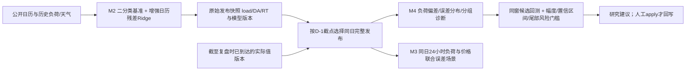

# v1.2.1：日历增强与真实预测误差风控

版本：`1.2.1-research`，2026-11-12。基线：`69cf1547f062a0edbe02ee329217f4504e3c4778`。

本次针对两个问题做小迭代：M2工作/休息二分类遗漏星期和长假阶段；风险评估需要使用当前预测模型实际发生的误差。M4在本仓库的职责是复盘、风险诊断与调参；M3负责申报系数求解，本次仅同步必要的误差数据衔接。采用系数仍为1，未接自动申报，也未设定新的经营损失预算。

## 数据如何进入模型



## M2：稳定基准，加上更细的日历表达

基础负荷仍由28日窗口的工作/休息同类、同小时历史加权得到，14日半衰期不变。默认`day_type_granularity: binary`。

残差模型新增`training.calendar_features: enhanced`，在原有日历/天气/滞后负荷上增加26列：7个星期标记、14个星期与首阶小时正余弦交互、假期序号与剩余天数、节后第1至3自然日。调休工作日与普通周末分别表达；增强日历的假期邻日标记排除带假期名称的调休工作日。未来公开日历可以使用，未来实际负荷和价格不能用作特征。

```text
负荷预测 = 同类同小时基础曲线 B + 近期负荷尺度 × Ridge预测的归一化残差
```

可用`calendar_features: basic`保持原特征作同窗对照。它保留历史邻日标记的旧行为，不能把其旧缺陷称为真实生产状态。新增特征不包含企业停产、检修、班次和复工计划，也没有把社会工作日等同企业开工。

六类日型保留为选项，并修正软借样本的公式：

```text
B = (同型加权总量 + soft × 借用加权总量)
    / (同型权重 + soft × 借用权重)
```

旧分母没有乘`soft`，无同型样本且借用值均为100、soft=0.5时会算出50；修正后保持100。因此旧实验的六类退化不能全部归因为过拟合，需重新做相同窗口对比。本次不自动启用六类，也不宣称新增26列已经降低真实业务WMAPE。

同时修复fixed规格仍被标为validation_selected的元信息，固定配置现在显示`fixed_specification`。披露价格特征只接受在对应D-1配置截点前收到的版本；历史补录、迟到修订和未知接收时间不进入该时点特征。接收时间仍不等于交易中心原始发布时间认证。

## M3必要衔接：真实误差与代理误差分列

优先读取目标模型同版本、事前发布、同一次完整24小时M2预测，并与本次风控截点前已收到的实际负荷/DA/RT配对。排除回放、事后发布、缺失小时及晚到实际；保留运行ID、模型版本、原始发布时间和实际版本来源。

默认`historical_error_source: prefer_m2_publications`，同版本完整且可构造非负负荷的日场景达到`minimum_m2_error_days: 30`才用真实发布误差；不足时输出明确的`proxy_research_fallback`研究场景。`require_m2_publications`模式下不足直接停止；`proxy_only`仅供旧研究对照。未达到30天不能把代理情景称为当前模型真实误差。

负荷和价格误差按同一天24小时整条配对，保留同小时与跨小时关联，不逐小时随机拼接。历史90日proxy回测另行保留，不与真实发布残差混成一组效果指标。场景仍采用现有MWh绝对残差平移；负荷规模变化时的尺度化误差、更多压力场景和已确认经营预算需后续单独验证。

## M4：把负荷误差变成可审查的风险证据

新增只读负荷误差诊断，按每目标唯一的事前原始预测和已到实际值配对，避免多次发布重复计权。报告输出预测偏差、WMAPE、误差分位数、样本小时/完整日、小时/日型/近期/模型版本分组及来源审计。样本不足明确标记，不填成零误差或零风险。

本版本误差符号统一解释为`actual - forecast`：正值表示低估，负值表示高估。持续偏差提示先校正预测水平；误差分布较宽提示需要评估更大的不确定性，两者不能混为一谈。诊断不会直接改预测、系数或资金预算。

```text
实际申报敞口 Q-L = (k-1)F - (L-F)
```

所以k=1仍可能有负荷误差敞口。风险效果应同时看基于当前结算口径的整体偏差损失和相对k=1的调整增量；调整增量为正不等于整体风险合格。

调参修复与新增门槛：

- 修正日差方向：负荷/价格为基准损失减候选损失，风险为候选收益减基准收益；正数统一表示改善。
- 建议生成与apply共同要求配置的改善幅度门槛和CI下界大于0，保留默认5%，显著但幅度不够不会生成可采纳建议。
- 风险候选额外检查验证段日损失CVaR、按基准限额计算的超限比例；另以原历史窗口、原置信度、原误差折减及原每日限额重新评分场景超限、CVaR与可行性。候选自身放宽置信度不能制造通过；基准CSV SHA及场景/配置哈希需一致，apply从逐日审计重验。收益增加但风险恶化不能通过；缺证据则阻断。
- 增加basic/enhanced日历候选，使新特征可以通过相同窗口的负荷回测评估。

CI与这些风险指标均为有限样本的研究证据，不代表总体概率保证或完整经营风控认证。M4既有历史调参回放仍有最终快照与代理模型限制。

## 发布完整性与验证

补回公开版漏发的`load_forecast/inputs/`源码及对应gitignore例外。来源为本地原项目适配代码，仅恢复Python源码；沿用现有归一化契约测试，再补空表拦截与就绪检查。没有复制业务数据库、真实负荷、价格、天气记录或训练模型。

测试入口：

```bash
python run_tests_windows.py
python -m unittest discover -s disclosure_ingest/tests -v
```

统一入口包含六套测试：162项中159通过，3项因公开版缺业务数据库/原始披露ZIP而显式跳过。验证记录见[本版本验收记录](docs/validation/v1.2.1/README.md)。这些测试验证计算与数据边界，不代表新模型已在真实经营样本上提高精度、收益或降低损失。

## 使用与回退

新版本按原安装和入口运行。请先在研究环境保存现有配置与数据库备份，检查新增误差报告的样本量、版本和来源。没有真实历史发布时积累今后原始快照；不能伪造过去的发布记录来满足门槛。

日历单项对照：把`load_forecast/config.yaml`中的`training.calendar_features`改为`basic`。六类保持关闭；soft修复不回退。完整版本回退使用原分支/基线提交及原环境配置；已经发生的人工apply按原`rollback`事务流程恢复。不要用覆盖数据库或删除历史记录作为版本回退。
